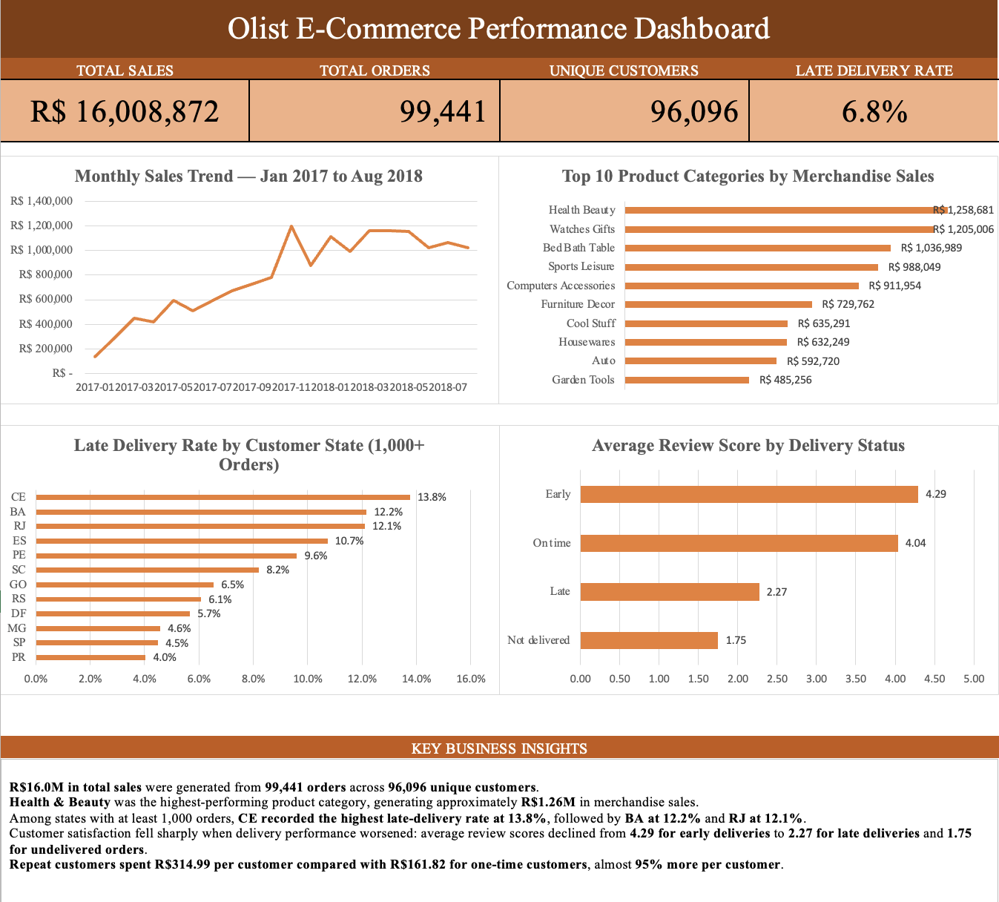

# Olist E-Commerce Performance Analysis

## Project Overview

This project analyzes the Brazilian Olist e-commerce dataset to evaluate sales performance, customer behavior, delivery performance, and customer experience.

The analysis was completed in Microsoft Excel using Power Query, PivotTables, PivotCharts, calculated fields, KPI development, and dashboard design. The goal was not only to summarize performance, but to identify operational issues and business opportunities that could support better decision-making.

## Business Questions

The project was designed to answer questions such as:

- How much revenue did the business generate?
- How many orders and unique customers were recorded?
- Which product categories generated the most merchandise sales?
- Which customer states experienced the highest late-delivery rates?
- How did delivery performance relate to customer review scores?
- How did repeat customers differ from one-time customers in spending?
- How did monthly sales change over time?

## Dataset

The project uses the Brazilian E-Commerce Public Dataset by Olist.

Key dataset scale:

- **99,441 orders**
- **112,650 order-item records**
- **96,096 unique customers**
- **32,951 products**

The analysis combines multiple relational datasets covering orders, order items, customers, products, payments, reviews, sellers, geolocation, and product-category translations.

**Source:** Brazilian E-Commerce Public Dataset by Olist on Kaggle  
https://www.kaggle.com/olistbr/brazilian-ecommerce/home/

> Raw CSV files are not included in this repository. They can be obtained from the original Kaggle dataset.

## Tools & Techniques

- Microsoft Excel
- Power Query
- PivotTables
- PivotCharts
- Data cleaning and transformation
- Relational table merging
- Calculated fields
- KPI development
- Dashboard design
- Data-quality auditing

## Key KPIs

| KPI | Result |
|---|---:|
| Total Sales | **R$ 16,008,872** |
| Total Orders | **99,441** |
| Unique Customers | **96,096** |
| Late Delivery Rate | **6.8%** |

## Key Findings

### 1. Health & Beauty led merchandise sales
Health & Beauty was the highest-performing product category, generating approximately **R$1.26M** in merchandise sales.

### 2. Delivery performance varied substantially by state
Among customer states with at least 1,000 orders, **CE recorded the highest late-delivery rate at 13.8%**, followed by **BA at 12.2%** and **RJ at 12.1%**.

### 3. Poor delivery performance was associated with lower customer satisfaction
Average review scores declined from **4.29 for early deliveries** to **2.27 for late deliveries** and **1.75 for undelivered orders**.

### 4. Repeat customers spent considerably more
Repeat customers spent approximately **R$314.99 per customer**, compared with **R$161.82 for one-time customers** — almost **95% more per customer**.

### 5. Sales grew strongly through 2017
Monthly sales increased strongly through 2017 and remained around **R$1M+ per month** during much of 2018.

## Data Cleaning & Quality Work

The workbook includes a dedicated **Data_Audit** sheet documenting the quality checks performed across the source tables.

Examples of the cleaning and validation work include:

- Retaining legitimate missing values where absence carried business meaning instead of automatically imputing them.
- Removing **261,831 exact duplicate geolocation records**.
- Flagging **31 geographic coordinate outliers** and excluding them from representative location calculations.
- Standardizing missing product categories.
- Adding manual English mappings for two previously untranslated Portuguese product categories.
- Preserving one row per ZIP code in a geolocation lookup to avoid row multiplication during joins.
- Validating order, payment, review, customer, product, and seller identifiers before analysis.

## Download the Full Workbook

The complete Excel and Power Query workbook is available as a GitHub Release.

[Download Olist_Ecommerce_Analysis.xlsx](https://github.com/reechardibrahim147/olist-ecommerce-performance-analysis/releases/download/v1.0/Olist_Ecommerce_Analysis.xlsx)

## Dashboard

The final Excel dashboard presents four core KPIs and four supporting visual analyses:

- Monthly Sales Trend
- Top 10 Product Categories by Merchandise Sales
- Late Delivery Rate by Customer State
- Average Review Score by Delivery Status

A final business-insights section summarizes the main findings for decision-makers.



## Workbook Structure

The recruiter-facing workbook keeps the following sheets visible:

1. `README`
2. `Dashboard`
3. `Product_Category_Analysis`
4. `Seller_Analysis`
5. `Delivery_Performance`
6. `Sales_Trend`
7. `Customer_Experience`
8. `Customer_Behavior`
9. `Data_Audit`

Raw and helper tables are preserved in the workbook but hidden to keep the final file clean and easy to navigate.

## Important Analysis Notes

- The monthly sales trend covers **January 2017 to August 2018** to avoid incomplete edge months.
- Overall KPIs use the full available dataset.
- The late-delivery state comparison is limited to states with **1,000+ orders**.
- Delivery performance and review score are described as **associated**, not causal.
- The late-delivery rate is calculated using delivered orders where delivery timing can be evaluated.

## Repository Structure

olist-ecommerce-performance-analysis/
├── README.md
└── dashboard.png

Full Excel workbook: available in the GitHub Releases section (v1.0).
```

## Project Takeaway

This project demonstrates the full Excel analytics workflow:

**Raw relational data → Data audit → Power Query transformation → Data modeling → Analysis → Dashboard → Business insights**

The main lesson from the project is that a useful dashboard should do more than display metrics. It should connect operational performance, customer behavior, and customer experience to clear business decisions.
